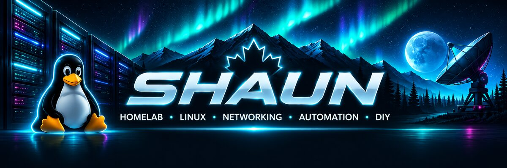
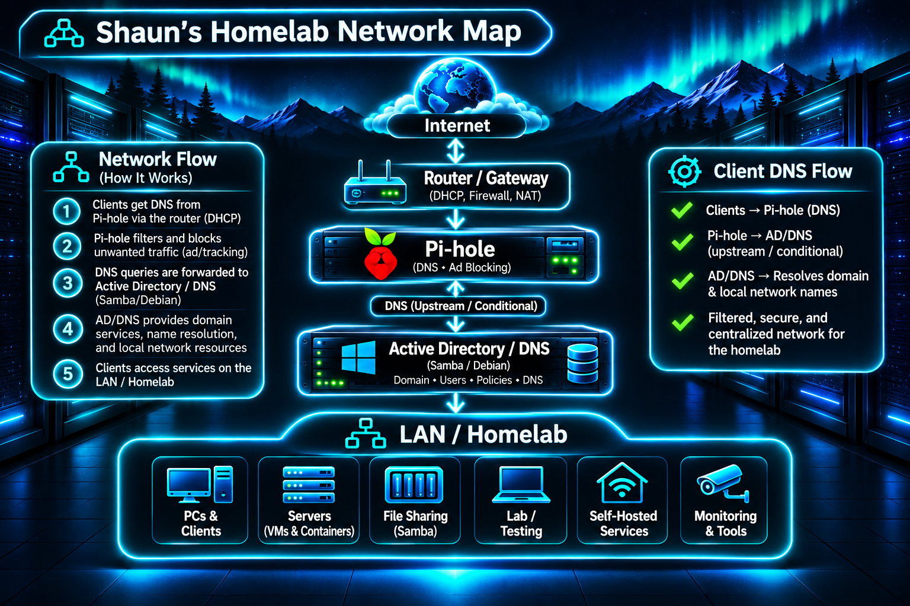

<!-- Shaun's GitHub profile -->

### `HOMELAB` · `LINUX` · `NETWORKING` · `AUTOMATION` · `DIY`

**I build it, break it, troubleshoot it, and learn how it works.**

<table>
<tr>
<td width="62%" valign="top">

## 👤 ABOUT ME

I'm a hands-on tech enthusiast who enjoys building software, running home infrastructure, troubleshooting networks, and digging into how complex systems work under the hood.

🐧 **Daily environment:** Ubuntu Linux  
🖥️ **Homelab:** ZimaOS, containers & self-hosted services  
🌐 **Networking:** DNS, Pi-hole, Samba Active Directory  
💻 **Code:** Python, Bash, C#, C++ & SQL  
🔧 **Mindset:** Solve it, understand it, improve it  
🚀 **Curiosity:** Hardware, mechanics, physics & space

</td>
<td width="38%" valign="top">

## 🖥️ MY SETUP

⚡ **AMD Ryzen 9**  
🧠 **32 GB DDR4 RAM**  
🎮 **Radeon RX 6800 XT**  
🔩 **ASUS Prime B550M-A**  
📦 **NZXT H5 Flow**  
🐧 **Ubuntu Linux**  
🏠 **ZimaOS / Homelab**  
📡 **TP-Link Networking**

</td>
</tr>
</table>

<table>
<tr>
<td width="50%" valign="top">

## 🧊 TECH STACK

  

</td>
<td width="50%" valign="top">

## 🗄️ HOMELAB & NETWORK

🍓 **Pi-hole** — DNS filtering  
🪟 **Samba AD / DNS** — directory services & local DNS  
🐳 **Containers & VMs** — isolated services  
🏠 **Self-hosting** — apps and infrastructure  
🌐 **Networking** — DHCP, DNS & troubleshooting  
⚙️ **Automation** — scripts and repeatable workflows

</td>
</tr>
</table>

### 🌐 HOMELAB NETWORK MAP

DNS path: Internet / upstream DNS → Pi-hole filtering → Samba Active Directory / DNS → LAN & homelab clients

## 🎯 CURRENT RABBIT HOLES

<table>
<tr>
<td width="33%" valign="top">

### 🗄️ Homelab

✓ Self-hosting  
✓ DNS / Network  
✓ Active Directory  
✓ Containers & VMs  
✓ Automation

</td>
<td width="33%" valign="top">

### 💻 Software

✓ Python  
✓ Bash  
✓ Systems programming  
✓ Debugging  
✓ Tools & scripts

</td>
<td width="33%" valign="top">

### 🪐 Curiosity

✓ Physics  
✓ Space  
✓ Hardware  
✓ Mechanics  
✓ How things work

</td>
</tr>
</table>

## 🐙 GITHUB ACTIVITY

## 💙 WHAT I'M INTO

## 🖥️ HARDWARE

 

### `BUILD IT` · `BREAK IT` · `UNDERSTAND IT` · `IMPROVE IT`

*“Whatever you do, work heartily, as for the Lord and not for men.”*  
**— Colossians 3:23 (ESV)**

